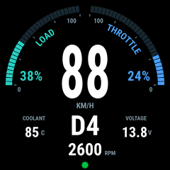
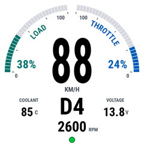
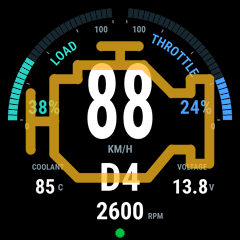
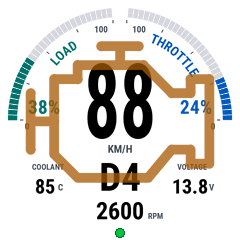

# Driving page implementation — 0.4.0

Implemented and flashed on 2026-10-30. ESP32 DevKit V1, seven-pin GC9A01,
PlatformIO environment `esp32doit-devkit-v1-image-dimming`. Final firmware ELF
prefix: `84c6e505`. USB bench checks passed; new-page live polling has not yet
been tested in the car.

## Visual result

The new second page follows the approved prototype: load/throttle arcs and
curved labels, centred speed, gear, independently centred RPM, and coolant and
adapter voltage beside the gear. Both themes retain the button brightness
control. Engine data moves to page three; diagnostics moves to page four.

These are images produced by the actual C++ renderer, not photographs:

| Night | Day |
| --- | --- |
|  |  |
|  |  |

[Renderer/prototype comparison](driving-page-0.4.0-preview.png). Small differences
come from RGB565 and four-bit antialiasing. The circular status dot remains the
existing firmware indicator.

The large MIL outline has a transparent interior and no backdrop. Only its
amber border pulses, 40% → 75% → 40% over two seconds. It is composited while
transferring pixels, so the base dashboard never accumulates painted trails.
The real ECU MIL state enables it on any page; the small DEMO warning icons do
not activate it. The USB preview command starts disabled after reboot.

## Live requests

Driving-page-only requests are 010C (RPM), 0104 (calculated load), 0111 (throttle
position), and the tested Hyundai LM 7E1/7E9 21A0 transmission block. The
driver-confirmed mapping is payload byte 20: 8=D, 9=N, 10=R, 11=P; byte 21:
forward gears 1–6. Unknown selector codes show `--`; D with an unknown gear
shows D. No new guesses about body warnings or other vehicle-specific fields
were introduced.

One speed request separates optional transactions. Existing 10-second MIL and
20-second coolant/voltage monitors retain priority. Leaving the page stops new
driving requests and finishes any active route restoration before ordinary
queries resume. Gear routing has a total 1.2-second budget; a missing prompt
forces reconnect and disables that probe until reboot. Standard missing values
and prompted malformed replies are handled independently of valid speed.

The 120-second scheduler model (90 seconds driving, then page exit; 60 ms per
reply) produced 274 speed samples, 40 each RPM/load/throttle, and 39 transmission
samples. Maximum speed gap was 790 ms, with extra readings about every 2.2
seconds during driving. This is a model, not an in-car timing measurement.
The original speed page does not start these new requests.

## Verification

- [Host checks](driving-page-0.4.0-checks.txt): passed with address/undefined
  behaviour sanitizers, including recorded transmission replies, route
  cancellation/timeouts, polling order and page exit, missing/stale values,
  value-width redraws, both themes, banded framebuffer guards, and overlay
  clearing without changes to base pixels. Existing speed, warning, button,
  diagnostics and flash-journal checks also passed.
- [Build](driving-page-0.4.0-build.txt): passed. Static RAM 55,344 bytes; flash
  1,127,497 bytes of the 2 MiB application partition. Artwork remains in flash;
  no additional framebuffer was allocated.
- [Upload](driving-page-0.4.0-upload.txt): passed with flash verification.
- [USB runtime](driving-page-0.4.0-serial.txt): all four pages and warning preview
  exercised without a panic. Main stack minimum free 1,256 bytes; worker 1,944
  bytes; pending Bluetooth events zero at the sampled health report. Sampled
  free heap 35,980–40,336 bytes. Final steady DEMO frame maximum 567 µs; the
  pulse-only window maximum was 101,695 µs (approximately 10 FPS), and the
  largest page-change window maximum was 406,812 µs. These are sampled maxima,
  not guarantees for a Bluetooth-connected drive.
- Existing NVS diagnostics report loaded as valid (7,608 bytes). Explicit USB
  export still reported session 3, active time 605,280 ms, completed candidate
  sweep. No report format or partition layout changed.

Final bench state: page two, NIGHT, DEMO example 88/D4/2600, image brightness
100%, overlay preview off. Reboot still starts on the original speed page.

Next car check: select page two, confirm LIVE and real RPM/load/throttle/gear,
then review logs for transmission timing and speed cadence. No adapter was
available during this PC bench check, so physical vehicle behaviour and a real
MIL event remain unverified for this version.
