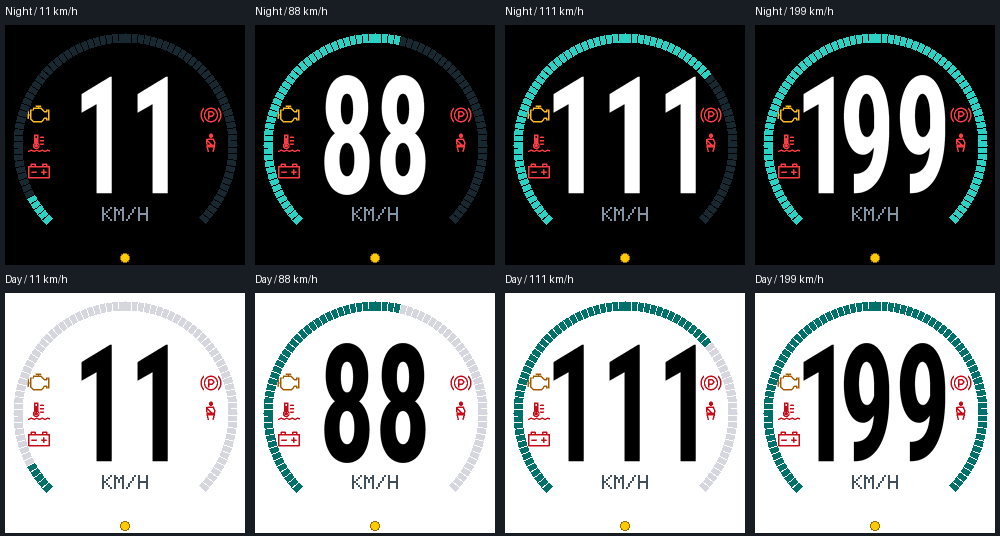

# Speed page side warnings — 0.4.1

Implemented and flashed on 2026-10-31 for the ESP32 DevKit V1 and 240×240
GC9A01. Firmware ELF prefix: `35321489`.

The speed page now keeps the largest 120px-high reading at its original
position, with warning icons in two side columns. Six 24×20px slots fit around
the central reading; the current five warning types occupy up to five slots.
Activation order remains upper left, upper right, then the next pair down.
Clearing an icon closes the gap; repeated active readings do not reorder it.

The KM/H unit, outer speed arc and status dot retain their positions. Warning
changes clear only the side slots. Number updates clear only the central strip,
so neither update erases the other. Icon pixels and clearing stay inside the
arc. The full-size glyphs retain their original width through 199 km/h; 200–255
are fitted horizontally inside the central strip while retaining 120px height.
There is no warning-dependent resizing.

This image comes from the actual C++ renderer, showing 11, 88, 111 and 199 km/h
in both themes. It is not a photograph of the display.

## Validation

- [Host checks](speed-side-warnings-0.4.1-checks.txt): all passed with address and
  undefined-behaviour sanitizers. Checks cover every warning subset, activation
  order and removal, fixed digit height, centred three-digit readings, speed
  transitions through 255, unchanged side icons, clean redraw equivalence,
  hidden-page changes, themes, framebuffer guards and the dimming indicator.
  Existing OBD, diagnostics, driving page, MIL overlay and journal checks pass.
- [PlatformIO build](speed-side-warnings-0.4.1-build.txt): passed for
  `esp32doit-devkit-v1-image-dimming`; static RAM 55,344 bytes, application flash
  1,127,285 bytes.
- [Upload](speed-side-warnings-0.4.1-upload.txt): flashed and verified over USB.
- [USB runtime](speed-side-warnings-0.4.1-serial.txt): boot and a complete DEMO
  speed cycle checked after flashing. The previous 7,608-byte diagnostics report
  remains readable. Observed draw maxima were 59.8–95.6 ms; free heap
  36,052–36,280 bytes, main stack minimum free 1,256 bytes, worker 1,944
  bytes, pending Bluetooth events zero at the sampled health report. No panic
  was recorded. Bench validation uses serial logs and renderer images.

No OBD polling, warning thresholds, page order, button gestures, stored report
format or Check Engine overlay behaviour changed. The firmware starts on the
speed page, with all five synthetic warning icons in DEMO and the usual measured
warnings in LIVE.
