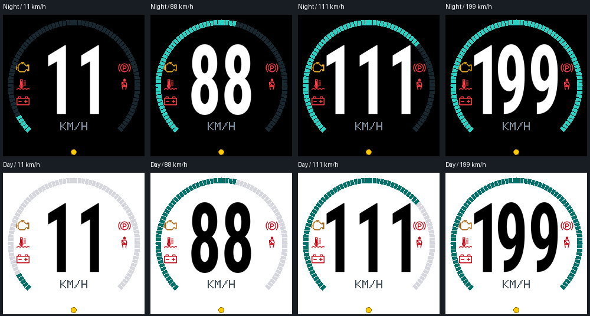

> **Disclaimer:** The code in this project is fully vibe-coded with **Codex (GPT-6.1 Sol High)**. This is an experimental hobby project; review and test it for your hardware and vehicle.

# ESP32 Bluetooth OBD2 dashboard

A compact car dashboard built from an ESP32 DevKit V1, a round 240×240 display,
and one button. It connects wirelessly to an ELM327-compatible Bluetooth OBD2
adapter and displays vehicle data. The firmware uses **PlatformIO + ESP-IDF**.

The current source version is **0.4.1**. The active PlatformIO project is in
[`CAR_OBD/`](CAR_OBD/).



The images above are previews produced by the firmware's renderer.

## What it does

| Screen | Contents |
| --- | --- |
| 1. Speed | Large speed reading in km/h, speed arc, and warning icons in two side columns. |
| 2. Driving | Engine-load and throttle-position arcs, speed, gear, RPM, coolant temperature and voltage. |
| 3. Engine data | Adapter voltage, coolant temperature and two oxygen-sensor voltage readings, where supported. |
| 4. Diagnostics | Experimental Hyundai data collection, candidate readings and a saved discovery report. |

The device starts in **DEMO** and searches for the adapter automatically. A
small **yellow dot** means DEMO; **green** means a fresh, valid vehicle-speed
reply was received. Lost connections or stale speed return the display to DEMO.
DEMO warning icons are synthetic examples, including parking brake and seatbelt;
they do not indicate measured faults.

Live warnings currently cover ECU-commanded Check Engine/MIL, high coolant
temperature and low adapter voltage. Check Engine also activates a large hollow
engine outline that pulses over the UI. Parking-brake and seatbelt polling is
disabled pending verified definitions for the tested vehicle.

## Compatibility

The development setup uses a Hyundai Tucson LM / ix35 and a **Vgate iCar Pro
Bluetooth 3.0**, advertised as `V-LINK`.

Speed, RPM, calculated engine load, throttle position and coolant temperature
use standard OBD requests. Availability still depends on the vehicle and
adapter. Voltage comes from the adapter's `ATRV` supply measurement. Oxygen
sensor voltages are supported only when the vehicle implements the requested
PIDs; missing readings show `--`.

**Gear/PRND decoding and the focused diagnostics profile are Hyundai-specific.**
Their requests and byte mappings were investigated on the development car and
are not universal OBD definitions. The driving and diagnostics screens issue
these queries when selected. For a different make/model, adapt or disable those
manufacturer-specific paths before use; changing the adapter name alone does
not make gear decoding compatible. There is no vehicle-profile selector yet.

See the [firmware guide](CAR_OBD/README.md) and
[candidate analysis](CAR_OBD/docs/validation/candidate-ride-2026-10-30-analysis.md)
for the mappings and their limits. Earlier speed/OBD operation and transmission
captures were tested in the car; the latest combined driving screen has been
bench-tested and still needs an in-car validation run.

## Hardware

| Part | Requirements / tested setup |
| --- | --- |
| ESP32 development board | Original ESP32 DevKit V1, 4 MB flash, with Bluetooth Classic support. |
| Display | 1.28-inch round GC9A01, 240×240, SPI interface, 3.3 V-compatible module. Current module has seven pins and no LED/BL pin. |
| OBD2 adapter | ELM327-compatible **Bluetooth Classic SPP** adapter. Tested with Vgate iCar Pro Bluetooth 3.0 / `V-LINK`. BLE-only and Wi-Fi adapters are not supported by this firmware. |
| Button | One normally open momentary pushbutton. |
| Connections | Jumper wires or soldered connections; breadboard for prototyping. |
| Power and programming | USB data cable and regulated USB power. A computer is needed for flashing. |

Choose the original ESP32 for this build. ESP32-C3 and ESP32-S3 do not provide
the Bluetooth Classic radio used here; see Espressif's
[Bluetooth support table](https://docs.espressif.com/projects/esp-idf/en/v6.1/esp32/api-guides/bt-architecture/overview.html).

The OBD adapter plugs into the car's OBD2 port. It has **no wired connection to
the ESP32**. Power the ESP32 separately over USB, using a suitable regulated
vehicle USB supply in the car. Do not connect vehicle 12 V directly to ESP32
power pins. No GPS module, microSD card or ambient-light sensor is required.

### Wiring

Disconnect power before wiring. Use the board's GPIO numbers, which may differ
from physical header positions. This table matches
[`CAR_OBD/include/Pins.h`](CAR_OBD/include/Pins.h).

| Display / button connection | ESP32 DevKit V1 | Purpose |
| --- | --- | --- |
| Display VCC | 3V3 | Display power; verify your module's supply specification. |
| Display GND | GND | Common ground. |
| Display CS | GPIO25 | SPI chip select. |
| Display RST / RES | GPIO26 | Reset. |
| Display DC / A0 | GPIO27 | Data/command selection. |
| Display SDA / DIN | GPIO23 | SPI MOSI. |
| Display SCL / SCK / CLK | GPIO18 | SPI clock. |
| Button terminal 1 | GPIO21 | Button input, internal pull-up enabled. |
| Button terminal 2 | GND | Pressing the button pulls the input low. |

Despite the SDA/SCL labels on some displays, this is **SPI**, not I²C. No MISO
wire is used. The current seven-pin display has no backlight-control connection;
**GPIO4 stays disconnected**. For a four-leg tactile button, use terminals that
are connected only when pressed; the two legs on one side are often already
connected internally. No external button pull-up is needed.

The default build dims the **rendered image** between 50% and 100%. The display's
backlight stays powered, including its black-level glow. Modules with an LED/BL
pin can use a different build profile, but that pin's electrical interface must
be verified; see the [backlight details](CAR_OBD/README.md).

## Build and flash

### Set up with an AI coding agent

The root [AGENTS.md](AGENTS.md) provides setup, build, test and development
instructions for coding agents. Give your agent this repository and a prompt
such as:

> Read AGENTS.md and set up this project on my computer. Reuse existing tools
> where possible, install missing dependencies in an isolated environment,
> build the default firmware and run the host checks. Tell me what passed and
> what hardware details are still needed. Do not flash a board yet.

An agent that does not automatically load `AGENTS.md` can still read it when
explicitly asked. Desktop setup does not require a connected ESP32 or car.

### 1. Install the tools and open the project

Install [PlatformIO IDE for VS Code](https://docs.platformio.org/en/latest/integration/ide/vscode.html).
It includes PlatformIO Core; use its **PlatformIO Core CLI** terminal for the
commands below. A standalone
[PlatformIO Core installation](https://docs.platformio.org/en/latest/core/installation/index.html)
also works.

Clone the repository:

```sh
git clone https://github.com/al-serebrov/esp32-Car-OBD2-Dongle.git
cd esp32-Car-OBD2-Dongle/CAR_OBD
```

Open this `CAR_OBD` directory in PlatformIO. The separate `Car OBD Dashboard/`
directory is an earlier starter skeleton; the maintained firmware and build
configuration are in `CAR_OBD/`.

The project pins PlatformIO's Espressif32 platform to `6.12.0`, uses ESP-IDF
`5.5.0`, and fetches the GC9A01 component `2.0.4`. PlatformIO downloads the
toolchain and dependencies during the first build. You do not need to install
Arduino, LVGL or a separate ESP-IDF toolchain.

### 2. Configure your adapter and display

Edit [`include/Config.h`](CAR_OBD/include/Config.h) inside the project:

```cpp
constexpr char kAdapterName[] = "V-LINK";
constexpr char kAdapterPin[] = "1234";
```

Use your adapter's discoverable Bluetooth name and pairing PIN. Close any phone
app connected to the adapter before testing the ESP32 connection.

The same file contains poll intervals, warning thresholds and display
orientation settings. The tested display uses `kMirrorX=true`, BGR order and
color inversion. Another GC9A01 module may need different settings. Change
pin assignments in [`include/Pins.h`](CAR_OBD/include/Pins.h) if you change wiring.

### 3. Build

Run from `CAR_OBD/`:

```sh
pio run
```

The default environment is `esp32doit-devkit-v1-image-dimming`. To select it
explicitly:

```sh
pio run -e esp32doit-devkit-v1-image-dimming
```

| PlatformIO environment | Brightness behavior |
| --- | --- |
| `esp32doit-devkit-v1-image-dimming` | Default: scales image colors; suitable for the current seven-pin module. |
| `esp32doit-devkit-v1` | No brightness control; fixed-backlight setup. |
| `esp32doit-devkit-v1-backlight` | GPIO4 PWM; requires a verified GPIO-compatible backlight interface or suitable driver. |
| `esp32doit-devkit-v1-spi-dimming` | Experimental GC9A01 brightness commands; had no physical effect on the tested seven-pin module. |

Use the same environment for building and uploading.

### 4. Connect and flash the ESP32

Connect the board with a USB **data** cable, then list serial ports:

```sh
pio device list
```

Upload using the port shown for your board:

```sh
pio run -e esp32doit-devkit-v1-image-dimming -t upload --upload-port /dev/cu.usbserial-0001
```

Replace the example port with yours: macOS commonly uses `/dev/cu.*`, Linux
`/dev/ttyUSB*` or `/dev/ttyACM*`, and Windows `COM3`, `COM4`, etc. Close serial
monitors before uploading. If automatic flashing fails at connection, hold
**BOOT** while it connects and release when writing begins. Press **EN** to
restart if needed.

The supplied [`partitions.csv`](CAR_OBD/partitions.csv) assumes **4 MB flash**,
allocating 2 MiB for the application and 1,984 KiB for persistent logs. Keep this
partition layout when updating an existing device if you want to retain logs.
A full-chip erase removes saved data. OTA updating is not implemented.

### 5. Check the desktop DEMO

With the display wired, it should boot into the speed page and cycle
`11, 22, 33, …, 99, 111`, changing every three seconds. The dot should be yellow
without a car connection. You can check the display and button at your desk.

| Button action | Result |
| --- | --- |
| Single click | Toggle day/night theme. |
| Double click | Next screen: speed → driving → engine data → diagnostics. |
| Hold longer than one second | Toggle 50% / 100% brightness. |

For a vehicle test, plug in the OBD adapter, power the ESP32, and turn on the
ignition as required by the car. Once valid speed replies arrive, the status dot
turns green. Do initial setup and checks while parked. The diagnostics page
starts additional experimental requests when selected.

## Monitor and retrieve logs

From `CAR_OBD/`, open a serial monitor at **115200 baud**:

```sh
pio device monitor --port /dev/cu.usbserial-0001 --baud 115200
```

Replace the port as above. Commands are newline-terminated:

| Command | Action |
| --- | --- |
| `help` | List commands. |
| `logs` | Export retained flash-ring records. |
| `diagreport` | Export the latest saved diagnostics report. |
| `page 1` … `page 4` | Select a screen. |
| `brightness 50` / `brightness 100` | Set brightness for the selected build profile. |
| `overlaytest on` / `overlaytest off` | Preview/stop the large Check Engine outline. Does not set a vehicle fault. |
| `dimtest on` / `dimtest off` | Run/stop the temporary brightness test cycle. |

For a saved export, close the serial monitor and use
[`tools/read_field_logs.py`](CAR_OBD/tools/read_field_logs.py) with a Python
interpreter that has `pyserial` installed:

```sh
python3 tools/read_field_logs.py --port /dev/cu.usbserial-0001 --diagnostics --output docs/validation/my-ride.txt
```

For PlatformIO IDE, its bundled Python environment already includes pyserial;
use that interpreter if your system `python3` does not have it. The command
exports the raw ring and a separate `my-ride.diagnostics.txt` report without
erasing them. A large export can take several minutes.

Logs survive power cycles but use a bounded ring: old records are overwritten.
They contain requests, replies, Bluetooth discovery information, UI events and
runtime health. Only requested data is captured; this is not a passive recording
of every vehicle CAN message. The diagnostics report summarizes the latest run.

Raw captures, build/upload transcripts and derived ride files are ignored by
Git. Analysis notes, UI previews, host-check results and parser fixtures remain
versioned. Some historical reports link to local-only captures. Earlier commits
still contain the original logs; their history has not been removed.

## Project structure

```text
README.md                         Start here: hardware, setup and development
AGENTS.md                         Setup and development instructions for AI agents
CAR_OBD/                          Active PlatformIO / ESP-IDF project
  platformio.ini                  Board, pinned platform and build profiles
  CMakeLists.txt                  ESP-IDF project and firmware version
  sdkconfig.defaults              Bluetooth Classic and flash defaults
  partitions.csv                  Application, NVS and log storage layout
  include/                        Configuration, pin mapping and telemetry types
  src/
    main.cpp                      Startup, main UI loop and USB commands
    display/                      GC9A01 driver integration, rendering and dimming
    input/                        Button sampling, debounce and gestures
    obd/                          Bluetooth SPP, ELM327 parsing/polling, Hyundai probes
    telemetry/                    DEMO values and warning-state logic
    logging/                      Persistent flash journal and log export
  test/host/                      Native C++ checks and recorded-response fixtures
  tools/                          Log export and font/artwork generation scripts
  assets/fonts/                   Roboto Condensed source and OFL license
  docs/validation/                Findings, UI previews and local captures
  README.md                       Detailed firmware notes and development history
Car OBD Dashboard/                Original starter skeleton
```

## Development

Edit source under `CAR_OBD/`, build with `pio run`, and upload with the same
environment. Clean generated build output when needed:

```sh
pio run -t clean
pio run
```

Common changes:

| Change | Location |
| --- | --- |
| Adapter name/PIN, timing, warnings and panel orientation | `include/Config.h` |
| Display/button wiring | `include/Pins.h` |
| Speed screen and warning icons | `src/display/GaugeRenderer.cpp` |
| Driving screen and MIL overlay | `src/display/DrivingPageRenderer.cpp` |
| Add or change standard OBD polling | `src/obd/Elm327.*` |
| Bluetooth discovery, pairing and reconnects | `src/obd/ObdClient.*` |
| Vehicle-specific transmission support | `src/obd/TransmissionPoll.*` |
| Experimental discovery/candidate profile | `src/obd/DiagnosticRun.*` |
| Warning thresholds/state transitions | `include/Config.h`, `src/telemetry/EngineWarnings.h` |

OBD requests are serialized through one ELM327 session. A speed reading is
interleaved between optional transactions; adding more requests can increase
speed-update gaps. The Bluetooth worker and UI run independently, but the
adapter still handles one command at a time. Check timing and error recovery
when adding a reading. Manufacturer-specific routing must restore the standard
header/filter before normal polling resumes.

### Host checks

From `CAR_OBD/`, on a system with a POSIX shell and a C++17 compiler supporting
AddressSanitizer and UndefinedBehaviorSanitizer:

```sh
sh test/run_host_checks.sh
```

These run on the computer without an ESP32 or vehicle. They check rendering,
button gestures, warning states, OBD framing/parsing and scheduling,
transmission-route recovery, diagnostics and flash-journal behavior. They do
not establish that a PID is available or correctly mapped on another car.

### Fonts and static artwork

Normal builds use generated headers already in the repository. Regeneration
requires Python with Pillow 12.3.0 / FreeType:

```sh
python3 tools/generate_speed_font.py
python3 tools/generate_driving_assets.py
```

Roboto Condensed and its SIL Open Font License are included in
[`assets/fonts/roboto-condensed/`](CAR_OBD/assets/fonts/roboto-condensed/).

## Troubleshooting

| Symptom | Check |
| --- | --- |
| `pio` is not found | Use the PlatformIO Core CLI terminal in VS Code. |
| Board does not appear as a serial port | Try a data-capable cable and check the board's USB-to-serial driver. |
| Upload cannot connect | Close the serial monitor, confirm the port, and try the BOOT-button procedure above. |
| Display stays black | Recheck VCC/GND, SPI clock, reset and chip select against the table; a successful upload cannot detect a disconnected display. |
| Display is mirrored or colors look wrong | Check mirror, axis, inversion and BGR settings in `include/Config.h`. |
| Always in DEMO in the car | Check Classic SPP compatibility, adapter name/PIN, power/ignition, and whether a phone holds the connection; export logs. |
| Speed is LIVE but other readings show `--` | The PID may be unavailable, stale or rejected; inspect the reply before adding a decoder. |
| Gear looks incorrect on another vehicle | The built-in mapping is Hyundai-specific; it needs a verified request and decoder for that vehicle. |
| Night image still glows | Image dimming cannot turn down a hard-wired backlight. |

For implementation details and recorded findings, continue with the
[firmware guide](CAR_OBD/README.md) and
[validation notes](CAR_OBD/docs/validation/README.md).
